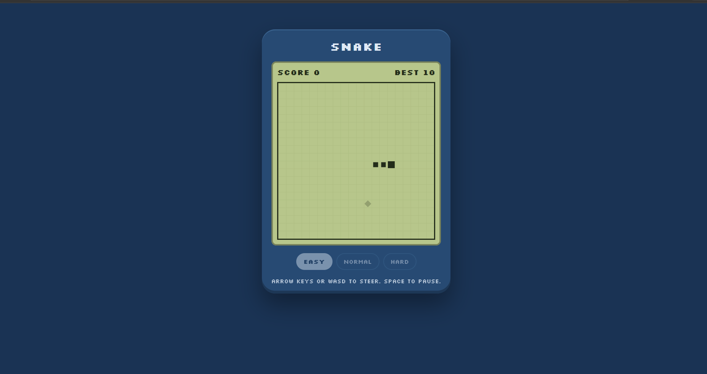

# 🐍 SnakeByte

A classic Snake game with a retro handheld LCD look, built with **Vue 3**, **TypeScript**, and **Vite**. This project was created as a hands-on way to learn the Vue 3 Composition API.

SnakeByte is a frontend-only game. It requires no backend or database.



## ✨ Features

- 🎮 Three difficulty levels: Easy, Normal, and Hard
- ⚡ Snake speed increases every 5 foods eaten
- 🏆 High scores saved separately for each difficulty using `localStorage`
- 📱 Responsive layout with touch controls
- 🕹️ Retro handheld LCD-style interface with a pixel font and CSS Grid
- ⏸️ Automatic pause when switching browser tabs
- 🎯 Keyboard and touch-based controls

## 🛠️ Tech Stack

- **Vue 3** — Composition API and `<script setup>`
- **TypeScript** — Type-safe development
- **Vite** — Development server and build tool
- **CSS3** — Responsive styling and CSS Grid
- **localStorage** — Persistent high scores

## 🚀 Getting Started

### Prerequisites

Install Node.js **20.19+ or 22.12+**.

### Installation

Clone the repository and navigate to the project directory:

```bash
git clone https://github.com/saubhagya02-bit/snake-byte.git
cd snake-byte
```

Install the dependencies:

```bash
npm install
```

Start the development server:

```bash
npm run dev
```

Open the local URL printed in your terminal, usually `http://localhost:5173/`.

### Available Scripts

| Command | Description |
|---|---|
| `npm run dev` | Starts the development server |
| `npm run build` | Type-checks and builds the production app |
| `npm run preview` | Previews the production build locally |

## 🎮 Controls

| Input | Action |
|---|---|
| Arrow keys / WASD | Steer the snake |
| Space / P | Start, pause, resume, or play again |
| Swipe on the game board | Steer on touch devices |
| On-screen D-pad | Steer on touch devices |

The game automatically pauses when you switch to another browser tab.

## 📂 Project Structure

```text
src/
├── main.ts                    # Application entry point
├── App.vue                    # Main layout and keyboard handling
├── style.css                  # Global styling
├── types.ts                   # Shared TypeScript types
├── utils/
│   └── game.ts                # Core game logic
├── composables/
│   ├── useSnakeGame.ts        # Game state and game loop
│   └── useHighScore.ts        # High-score persistence
└── components/
    ├── GameBoard.vue          # Game grid, snake, food, and swipe input
    ├── GameOverlay.vue        # Start, pause, and game-over screens
    ├── ScoreBoard.vue         # Current score and high score
    ├── DifficultySelect.vue   # Difficulty selection
    └── TouchControls.vue      # On-screen directional controls
```

## 📚 Vue Concepts Practiced

This project helped me explore the following Vue 3 concepts:

| Concept | Where to Find It |
|---|---|
| Composition API and `<script setup lang="ts">` | Vue components |
| Reactive state with `ref()` | `useSnakeGame.ts` |
| Derived state with `computed()` | Game and high-score composables |
| Composables | `src/composables/` |
| Props with `defineProps()` | `GameBoard.vue`, `ScoreBoard.vue` |
| Custom events with `defineEmits()` | `GameOverlay.vue`, `DifficultySelect.vue` |
| Two-way binding with `v-model` | `DifficultySelect.vue` |
| Template directives such as `v-for`, `v-if`, `:class`, and `:style` | `GameBoard.vue`, `App.vue` |
| Slots | `GameBoard.vue` |
| Lifecycle hooks | `App.vue`, `useSnakeGame.ts` |
| Browser APIs: keyboard, touch, and localStorage | Components and composables |

## ⚙️ How the Game Works

1. **State management:** `useSnakeGame.ts` manages the snake, food, direction, game status, and score.
2. **Game loop:** A recursive `setTimeout()` calls `tick()`, allowing the game speed to change dynamically.
3. **Movement and collision:** Each tick moves the snake, checks wall and self-collisions, and handles food collection.
4. **Direction queue:** Direction inputs are buffered to prevent rapid key presses from reversing the snake into itself.
5. **Rendering:** CSS Grid positions each snake segment and the food on the game board.
6. **Reusable game logic:** Pure functions in `src/utils/game.ts` separate core game rules from Vue components.


## 💡 Future Improvements

- Add sound effects.
- Introduce obstacles or a wall-wrap mode.
- Add unit tests for game logic using Vitest.
- Implement an online leaderboard with a backend.

## 👩‍💻 Author

**Ushani Saubhagya**

---

Built with 💚 using Vue 3 and TypeScript.
